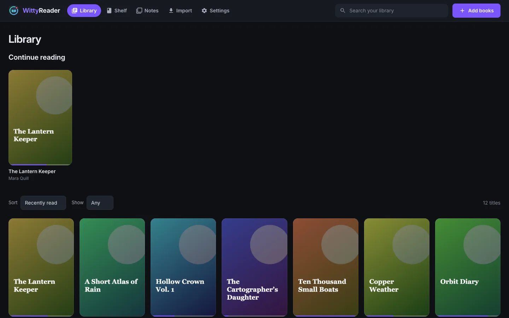
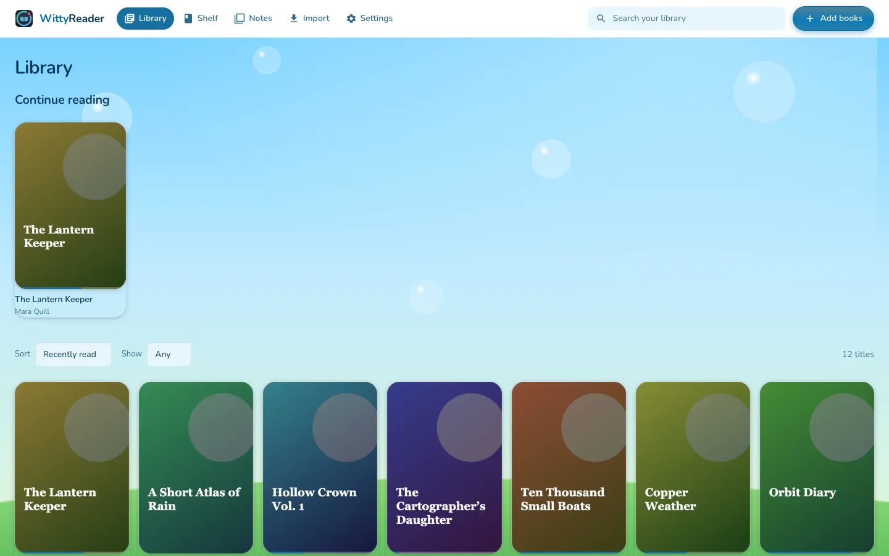
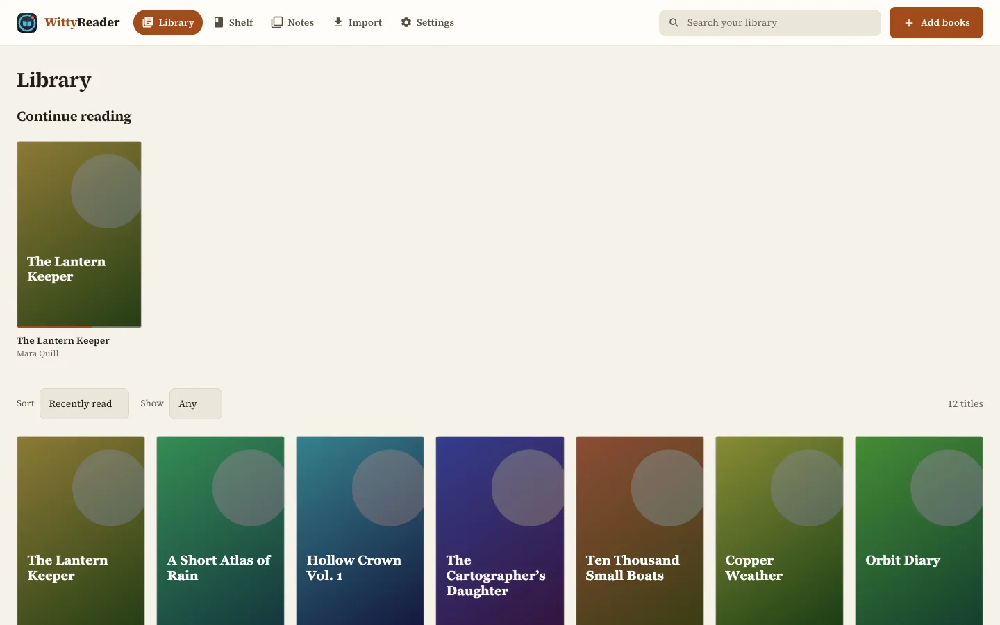
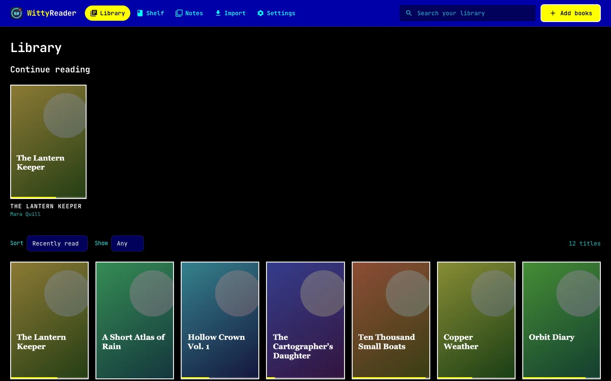
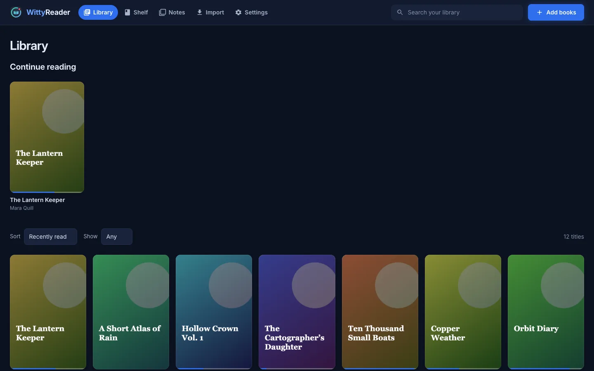
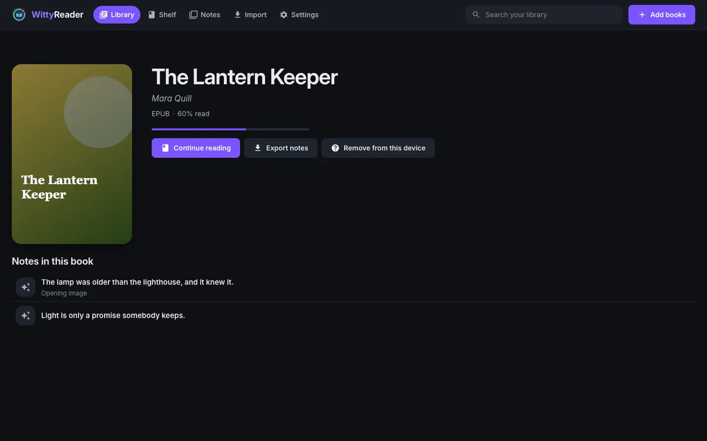
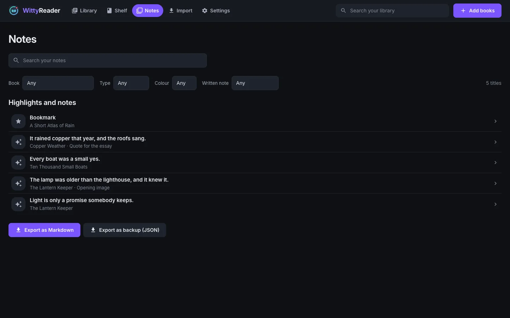
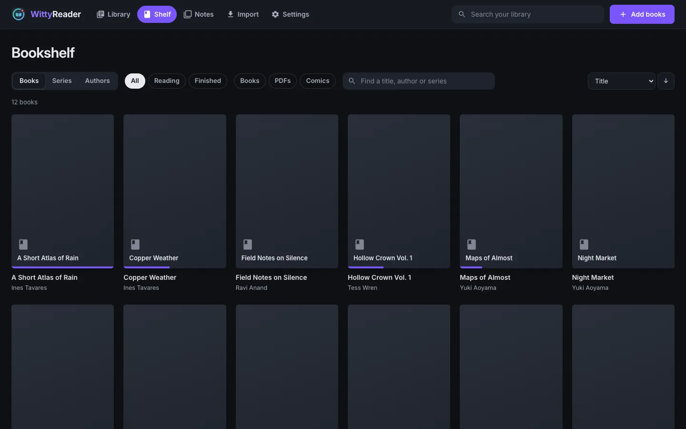
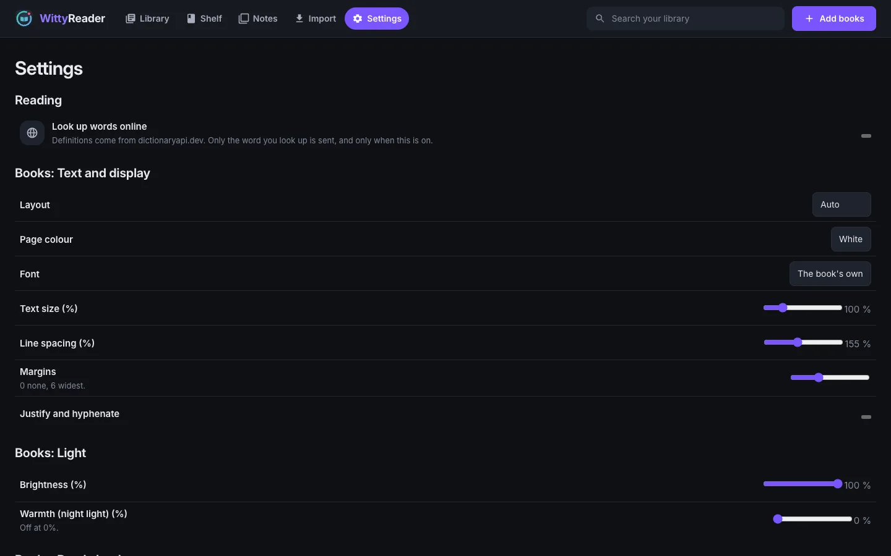

# WittyReader

Read and annotate books, PDFs and comics on your own device, with no server and nothing uploaded. You need it if you want the Witty readers without running a WittyMediaServer.

It's a standalone app, not a server module: an installed desktop app for Windows, macOS and Linux, and the same app as a static web app you can host yourself. It's part of the [WittyMediaServer](https://github.com/wittywilla/WittyMediaServer) family ([wittymediaserver.com](https://wittymediaserver.com)): it reads with the same reader modules as the server, and draws its screens with the server's own renderer and themes. The desktop app can also read from a WittyMediaServer you add.

<!-- pictures -->



<sub>A made-up library with covers drawn by the picture script: no one's media. Every screen but the book is drawn by WittyMediaServer's own renderer, in the same themes.</sub>














<!-- /pictures -->

## What it does

**Your library**

- **Add books your way:** the **Add books** button, Ctrl+O, the **Import** page, drag and drop, or your system's *Open with* once installed.
- **Continue reading:** the book you're in, front and centre, with your progress.
- **Find anything:** search, filter by books, PDFs or comics, and sort by recent, added, title or author. The **Shelf** groups books by series and author.
- **A page for each book:** Read or Continue reading, export its notes, remove it, and every note you made in it.
- **Covers and titles from the files:** EPUB metadata and covers, PDF first pages, a comic's `ComicInfo.xml`. Books without a cover get one of their own.
- **No duplicates:** adding the same file again finds the copy you have.

**Reading**

- **Books (EPUB),** with [WittyEbook](https://github.com/wittywilla/WittyEbook).
- **PDFs,** with [WittyPDF](https://github.com/wittywilla/WittyPDF).
- **Comics and manga (CBZ),** with [WittyComics](https://github.com/wittywilla/WittyComics).
- **Study tools** from [WittyInk](https://github.com/wittywilla/WittyInk): highlights, notes, bookmarks, citations, reading aloud, and a pen with pressure.
- **The readers' own settings** in Settings, the same ones a WittyMediaServer profile has.

**Your look**

- **Look and Theme, as on the server:** fourteen Looks (finish, shape, type and density) and fifteen themes, any Look with any Theme, or **Match this device**. The first start offers the choice.
- **Import a theme:** a ZIP of `theme.json`, `theme.css` and fonts or pictures, by the server's rules: variables and fonts only, nothing that reaches another site.

**Private and portable**

- **On the device:** books, positions and notes stay with you. The only outside requests are a dictionary look-up, off until you turn it on, and any server you add yourself in the desktop app.
- **Books can't run code:** EPUB files are sandboxed with scripts blocked, and PDF scripts and forms are off. Copy-protected (DRM) books are refused.
- **Notes go with you:** the **Notes** page lists every note from every book, with filters, and exports them as Markdown or as backup files you can import on another device.
- **Offline:** it works offline after the first visit.

The guides are in [wiki/](wiki/Home.md): [Getting started](wiki/Getting-started.md), [Your library](wiki/Your-library.md), [Reading](wiki/Reading.md), [Notes and backups](wiki/Notes-and-backups.md), [Privacy and security](wiki/Privacy-and-security.md) and [Troubleshooting](wiki/Troubleshooting.md).

## How to get it

The [releases page](https://github.com/wittywilla/WittyReader/releases) has an installer for each system, made by `electron-builder` from `desktop/`:

| You have | Download |
|---|---|
| Windows 10 or later | `wittyreader-<version>-windows-amd64-setup.exe` |
| A Mac with Apple silicon | `wittyreader-<version>-macos-arm64.dmg` |
| A Mac with an Intel chip | `wittyreader-<version>-macos-x64.dmg` |
| Debian, Ubuntu and relatives | `wittyreader-<version>-linux-amd64.deb` |
| Fedora and relatives | `wittyreader-<version>-linux-amd64.rpm` |
| Any other Linux | `wittyreader-<version>-linux-amd64.AppImage` |
| Your own web server | `wittyreader-<version>.zip`: see [Hosting and building](wiki/Hosting-and-building.md) |

Nothing is code-signed yet, so Windows and macOS warn about the installers. Installed, it opens `.epub`, `.pdf` and `.cbz` files from your system. Removing it asks whether to delete your library and notes as well, which can't be undone. [Installing and removing](wiki/Installing-and-removing.md) has the steps for each system, and every folder involved.

## What it needs

- **Installed:** nothing else. It brings its own Electron.
- **In a browser:** the web app is a plain static site, hosted over **https** or opened from `localhost`, because browsers only allow its offline service worker, which also shows EPUBs, on secure addresses. Connecting to a server needs the desktop app (or a web host whose security policy names that server).
- **To read from a server:** a WittyMediaServer you can reach, and a device already signed in to it to approve this one.

It's built on WittyEbook, WittyPDF, WittyComics and WittyInk, with pdf.js, React and fflate.

## Platforms

| System | Where it stands |
|---|---|
| Windows | The setup and uninstaller ran under Wine, in a throwaway container. Not on real Windows |
| Linux | `.deb` and `.rpm` installed, opened on a virtual screen, upgraded and removed in containers. No real desktop yet |
| macOS | The workflow builds for it, and that has not run yet. It has not been run on a real Mac. Its uninstaller's logic only ran on Linux with a stand-in home folder |

## Building and testing

You need [Node.js](https://nodejs.org) 22, as CI uses (`npm test` needs 22.6 or newer). To build against reader checkouts beside this one before they're released, run `node scripts/dev-modules.mjs` after `npm install`. It writes only `node_modules` links that git ignores.

```bash
npm install
```

```bash
npm run dev
```

```bash
npm run build
```

```bash
npm test
```

`npm run dev` serves it at `http://localhost:5180`, and `npm run build` makes the finished app in `dist/`. See [Hosting and building](wiki/Hosting-and-building.md). `npm test` checks the library, the pages, the theme engine and theme import, the connection rules, the comic reader's ZIP handling, and that the files copied from the server are unchanged.

The screens are server-driven pages made on the device and drawn by the server's renderer, copied into `src/web/` by `scripts/sync-web.mjs`. [docs/SDUI-ARCHITECTURE.md](docs/SDUI-ARCHITECTURE.md) has how that fits together.

The desktop app is in `desktop/`:

```bash
cd desktop
npm ci
npm test
```

`npm run package:win`, `package:mac` and `package:linux` make the installers. `scripts/test` has the checks that really install them:

- `scripts/test/installers-linux.sh` proves the Linux packages in throwaway containers.
- `scripts/test/installers-wine.sh` runs the Windows setup in a throwaway container with Wine.
- `scripts/test/mac-uninstaller.sh` runs the Mac uninstaller's logic against a stand-in home folder. It needs no Mac, and says nothing about a real one.

## Licence

GNU GPL v3.0 (or later): see [LICENSE](LICENSE) and [NOTICE](NOTICE). If you redistribute it or build on it, please keep the NOTICE attribution. The Witty plugins it is built from, and the WittyMediaServer renderer, stylesheets and themes copied into `src/web/` and `public/themes/`, are under the GNU AGPL v3.0 (or later); the fonts in `public/fonts/` are under the SIL Open Font License 1.1. NOTICE has the details.

Bundled in the built app: pdf.js (`pdfjs-dist`, Apache-2.0, Mozilla Foundation) with its image decoders (OpenJPEG, BSD-2-Clause; PDFium's JBIG2 decoder, BSD-3-Clause; qcms, MIT; each licence beside it in `assets/pdfjs-<version>/`), React and React DOM (MIT, Meta Platforms and affiliates), and fflate (MIT, Arjun Barrett). In the installers only, not in the zip: Electron (MIT), which bundles Chromium and FFmpeg, whose licences ship with every installed copy in `LICENSE.electron.txt` and `LICENSES.chromium.html`.

WittyReader is part of the WittyMediaServer project: [server repository](https://github.com/wittywilla/WittyMediaServer), [wittymediaserver.com](https://wittymediaserver.com).

<!-- module-kit -->
## Releasing

A version tag builds the web app and the desktop installers, and attaches them to a release. It isn't delivered through a server.

To release:

1. Raise `version` in `package.json` and in `desktop/package.json`, and commit it.
2. Tag that commit and push the tag: `git tag vX.Y.Z`, then `git push origin vX.Y.Z`. A tag with a
   suffix, such as `v1.2.0-beta`, is published as a prerelease.
3. Watch the *Actions* tab. Nothing is signed yet, so Windows and macOS warn about the installers: see [Installing and removing](wiki/Installing-and-removing.md).

Licensed under GPL-3.0-or-later: see [LICENSE](LICENSE) and [NOTICE](NOTICE).
<!-- /module-kit -->

## Legal

WittyReader is an independent open-source project. It isn't associated with, sponsored by or
endorsed by any publisher, rights holder, service or other media software project. No books come
with it, and it doesn't check the ones you open: you're responsible for having the rights to them.
Definitions come from a third-party service. Any third-party names here only describe what it works
with, and belong to their owners. It's provided “as is”, with no warranty; see [LICENSE](LICENSE).
Local law applies to how you use it. This isn't legal advice.
